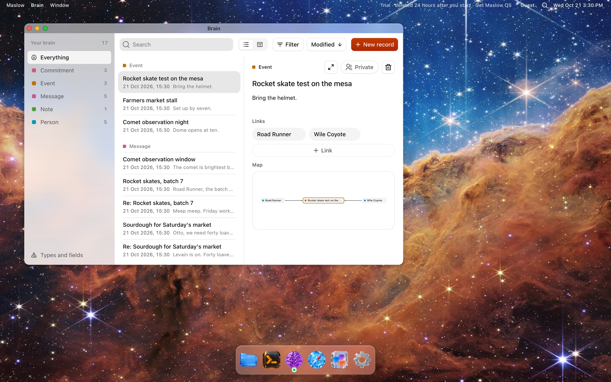
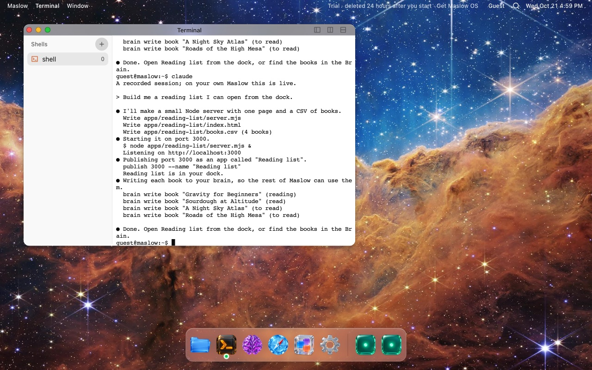
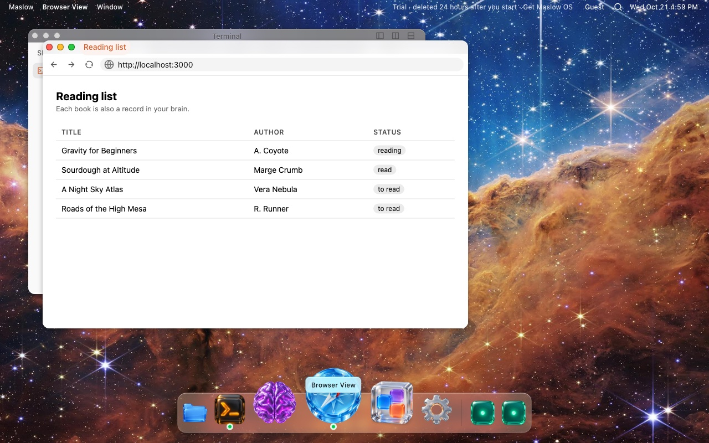
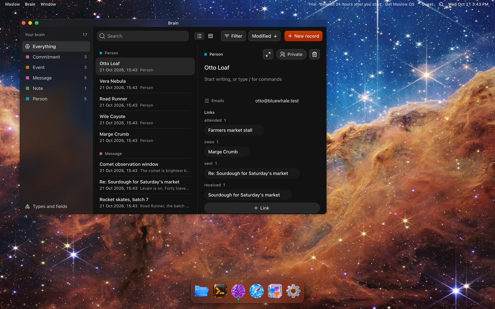
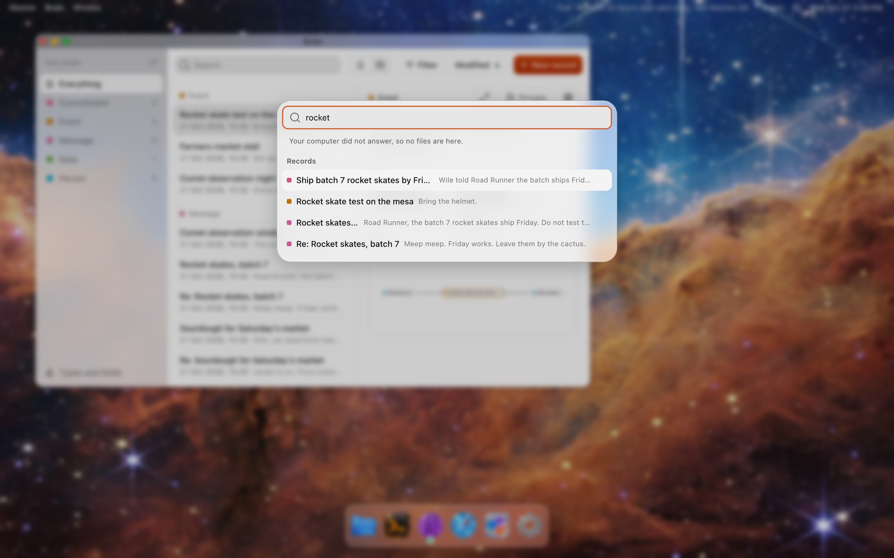
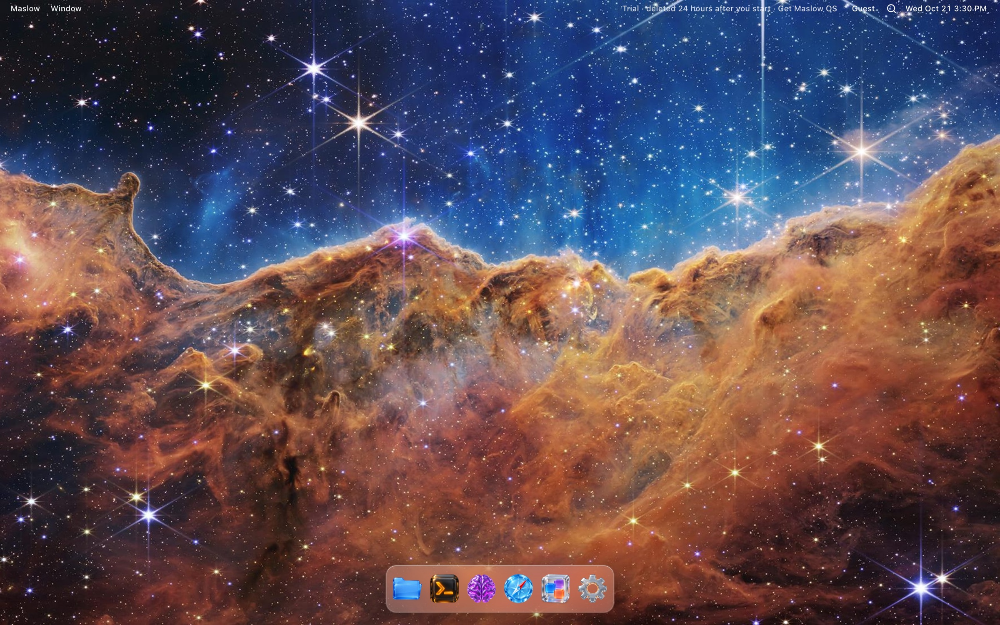
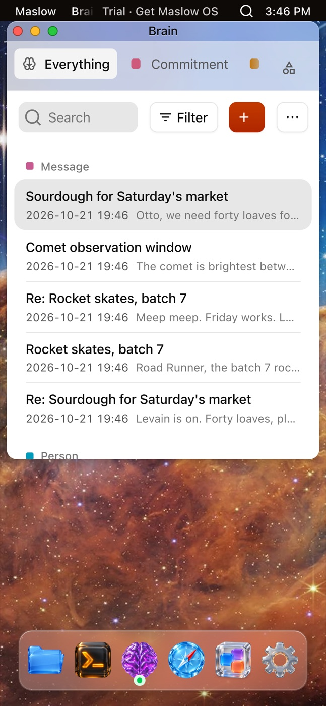
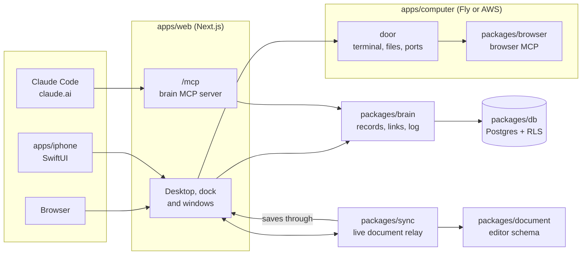

<div align="center">


# Maslow OS

**An internet computer you own, where Claude builds your apps and every app feeds your brain.**

[**Try it in your browser**](https://tanmai.org/maslow) · no sign-up, deleted after a day

[](LICENSE)
[](https://www.typescriptlang.org)
[](https://nextjs.org)
[](https://www.postgresql.org)
[](#claude-and-the-brain)

Built by [Tanmai Kalisipudi](https://github.com/tanmaik) and [Tanishk Govil](https://github.com/tanishkgovil).

<br />



</div>

## Own your intelligence

At Startup School in 2026, Garry Tan said intelligence of this kind
["should be owned by you, not rented."](https://www.ycrootaccess.com/p/garry-tan-own-your-intelligence)
He described his own setup this way: "My brain runs on my own infra, in my own
repo, under my own keys."

Maslow OS is that setup as a computer. Your brain lives in your Postgres. Your
computer runs in your cloud account. The code is AGPL, so you can read every
line that touches your data, and switch models whenever you like.

## Inside

**A desktop.** It looks and moves like the Mac you know: a menu bar, a dock,
windows you drag, resize and send full screen, ⌘K over everything, light and
dark, your own wallpaper. It runs in any browser and fits a phone.

**A brain.** Records in your own types, the links between them, and a numbered
log of every change that you can walk back. It is an MCP server, so Claude Code
and claude.ai read and write it as you, and every write they make is marked as
the model's.

**A computer.** A Linux machine in the cloud that keeps running when you close
the tab. It has a terminal that survives a restart, your files, a real browser,
and your own Claude Code, the word `claude` away and already connected to your
brain.

## How it grows

1. Open the terminal and run `claude`. The computer carries guides that tell
   Claude how Maslow works, how to build an app here and how to use your brain.
2. Ask for an app: a reading list, a run log, a tracker for whatever you care
   about. An app can be as small as one page Claude makes in a minute, an
   artifact that lives on your computer instead of in a chat.
3. Claude runs it on a port. Publish the port and it gets a name and an icon
   and sits in your dock like any other app.
4. Claude can wire the app to your brain, so what you put in it becomes records
   and links.
5. Your home folder is one filesystem that the terminal, the Files app, Claude
   and your apps all share. Drop in a CSV, a PDF or an export from another
   service, and Claude can read it into the brain.

<table>
<tr>
<td width="50%"></td>
<td width="50%"></td>
</tr>
</table>

## Features

<table>
<tr>
<td width="50%" valign="top">

### A brain of records and links

Each record has a type, a title, a body in markdown and the fields its type
declares. Links carry any verb you like (`owes`, `sent`, `attended`), and a map
shows what a record touches. Types are yours. Each is private until you share
it.

</td>
<td width="50%" valign="top">



</td>
</tr>
<tr>
<td width="50%" valign="top">



</td>
<td width="50%" valign="top">

### ⌘K finds anything

One field over the screen finds an app, a setting, a record or a file by its
words. An agent's `search` looks by words first, then by meaning through
embeddings.

</td>
</tr>
<tr>
<td width="50%" valign="top">

### Your apps in the dock

A port becomes an app when you publish it, with the name and face you give it.
It opens as a window or in its own tab. A stopped app leaves the dock on its
own.

</td>
<td width="50%" valign="top">



</td>
</tr>
</table>

### On a phone

<p align="center">

</p>

The same desktop fits a phone. A native iPhone app in `apps/iphone` (SwiftUI,
iOS 26) reads the same brain and shows what waits on you.

### Also in the box

- **Live editing.** While a record is open in 2 places, its body is 1 live
  document, and each save is 1 person's.
- **Connections.** Connect your outside accounts once. An agent reaches every
  connected app through 3 MCP tools: `apps`, `find` and `run`.
- **Notifications and asks.** An agent can `notify` you or `ask` you a
  question, and you answer it where it stands.
- **Your data leaves with you.** `packages/brain` exports your brain to a file
  that imports into any brain.

## Try it

[tanmai.org/maslow](https://tanmai.org/maslow) runs this repo with `TRIAL=1`.
Press Try it and you get a desktop of your own with made-up records. The
terminal, files, browser and apps are replays and fixtures, since a trial
gets no real computer. Everything you make is deleted 24 hours after you
start.

## Run your own

```
pnpm install && pnpm dev
```

That fetches a real Postgres binary from npm, migrates it, seeds 3 fictional
orgs (Acme Rockets, Blue Whale Bakery and Chartreuse Observatory) and prints
the URL. No Docker and no credentials are needed. Sign in by picking a seeded
person, such as Wile Coyote, on the sign-in screen. Vendors without keys are
faked, and the app says which.

Node 24 to develop on, 22.18 at the least, and pnpm.

To host it, `apps/web/Dockerfile` builds the app as 1 small server, and
`infra/aws` is a Terraform template that runs it, and a computer for each
person, in your own AWS account. Computers can also run on Fly. Sign-in codes,
dev secrets, vendors, the trial and what production requires are in
[docs/DEVELOPING.md](docs/DEVELOPING.md).

`pnpm check` is the merge gate. Read [CLAUDE.md](CLAUDE.md) before changing
anything, and [REVIEW.md](REVIEW.md) before merging.

## Claude and the brain

The brain is an MCP server at `/mcp`, behind the same sign-in as the site.
Give Claude Code the URL and it does the rest:

```
claude mcp add --transport http brain https://<host>/mcp
```

On claude.ai, add the same URL as a custom connector. Either way a browser
opens, you sign in and allow it, and Claude reads and writes your brain as
you. Every write it makes is logged as the model's. Disconnect it under Access
in Settings. Locally the host is the one `pnpm dev` prints; claude.ai cannot
reach a laptop.

The server offers tools to read (`catalog`, `list`, `get`, `graph`,
`search`, `history`), to write (`write`, `edit`, `remove`, `restore`,
`unlink`, `merge`, `unmerge`, `revert`, `redefine`, `undefine`), to share
(`share`), to reach you (`notify`, `ask`, `notifications`, `open`), to
arrange the desktop (`desktop`, `place`, `unplace`), and to act in connected
apps (`apps`, `find`, `run`).

## Architecture



| Path                | What it is                                                                                          |
| ------------------- | --------------------------------------------------------------------------------------------------- |
| `apps/web`          | The Next.js app: sign-in, the desktop, every window, the brain's MCP server at `/mcp`, and the sweep |
| `apps/computer`     | The image each person's computer runs, and its door: the terminal, files, ports and backups         |
| `apps/iphone`       | The native iPhone app                                                                               |
| `packages/brain`    | Records, links, types, search, sharing, history and revert                                          |
| `packages/db`       | Migrations, the seed, and connections as a restricted role under row-level security                 |
| `packages/sync`     | The relay that holds a record's live document and saves through the app                             |
| `packages/document` | The editor's schema, shared by the page and the relay                                               |
| `packages/browser`  | An MCP server that drives Chromium with Playwright                                                  |
| `infra/aws`         | A Terraform template to run Maslow in your own AWS account                                          |

## License

Maslow OS is licensed under the GNU Affero General Public License, version 3.
See [LICENSE](LICENSE), and [NOTICE](NOTICE) for the third-party code and
assets it carries.
